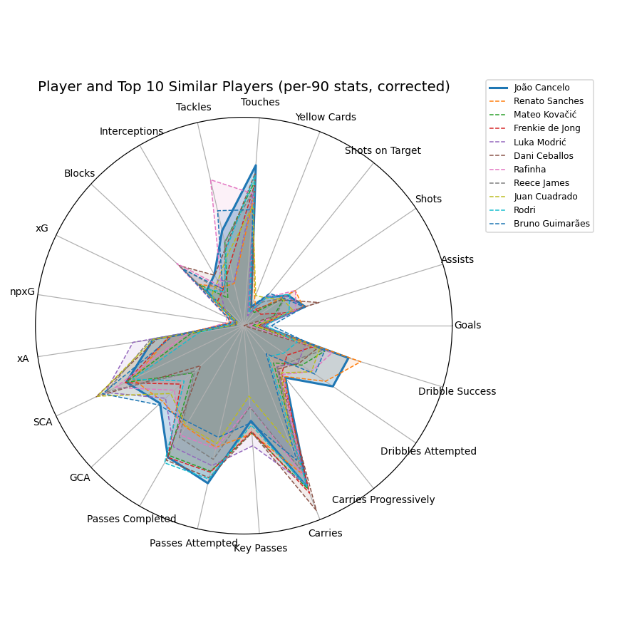

# Football Players Data Mining

## Overview
Sports statistics analysis has become increasingly important in recent years, to the point where professional clubs rely on it to support and guide their decisions. The goal of this thesis is to apply data collection and processing techniques to analyze football players' performance, computing similarity between them based on their in-game statistics.

The project works on a dataset containing match statistics from the five major European leagues (Premier League, Bundesliga, La Liga, Ligue 1, Serie A) and international competitions (Champions League, Europa League, Conference League), covering four seasons (2020-21 to 2023-24), scraped from [FBref](https://fbref.com/) and enriched with market values from [Transfermarkt](https://www.transfermarkt.com/). Player statistics are normalized and compared using Euclidean distance, enabling the discovery of statistically similar players regardless of name recognition or market value.

The thesis includes a real-world case study validating the model against Inter Milan's transfer market strategy (e.g. Marcus Thuram, Benjamin Pavard), showing how the similarity analysis aligns with the club's actual player recruitment choices.

This is the Bachelor's Degree thesis in Computer Science at the University of Catania (Academic Year 2023-2024), by Alessandro Sciacca. Supervisor: Prof. Giovanni Micale. Co-supervisor: Prof. Antonio Di Maria.

## Key Features
The key features of this project are:

**Web scraping pipeline**: automated collection of player statistics from FBref and market values from Transfermarkt across four seasons and eight competitions.

**Data cleaning and integration**: merging of per-season, per-competition datasets into a unified, cleaned dataset, enriched with market value data.

**Normalization and similarity computation**: Min-Max normalization of player statistics and pairwise Euclidean distance to quantify how similar two players are.

**Player comparison tools**: `get_top_n_similar_players` and `get_players_distance` functions to retrieve the most similar players to a given one, with optional filters on market value, role, and position.

**Case study**: validation of the similarity model against Inter Milan's real transfer market decisions.

## Repository Contents
- `football_players_data_mining.ipynb` — the original thesis pipeline: scraping, data cleaning, market value integration, normalization, similarity computation and the Inter Milan case study.
- `players_stats_20_21.csv`, `players_stats_21_22.csv`, `players_stats_22_23.csv`, `players_stats_23_24.csv` — cleaned per-season player statistics.
- `players_grouped_stats.csv` — player statistics aggregated across seasons (original methodology).
- `players_market_value.csv` — scraped market values.
- `players_stats_with_market_value.csv` — merged statistics and market value dataset (original methodology).
- `players_norm.csv` — normalized player statistics used for similarity computation (original methodology).
- `thesis.pdf` / `.docx` — full thesis document (Italian), as discussed and graded.
- `presentation.pptx` — thesis defense presentation slides (Italian).
- `fix_pipeline.py`, `case_study_fixed.py` — corrected similarity pipeline, see below.

Note: the Euclidean similarity matrices (original and corrected) are not included in this repository due to their size (~80-200MB), but can be regenerated by running the notebook / `fix_pipeline.py`.

## Methodology Review and Corrections
After the thesis was discussed and graded, a closer review of the similarity methodology surfaced a few design choices that can bias the "similar players" results:

1. **Season totals instead of per-90 rates.** The original pipeline compared cumulative season stats (goals, touches, passes, …), so two players with very different playing time looked "different" mainly because of minutes played, not playing style.
2. **Median on an ordinal position code.** `Position` was encoded as an arbitrary number (CB=1 … FW=12) and then averaged with a median across matches/seasons — for a player used in two very different roles, this can produce a "position" that doesn't correspond to any role he actually played.
3. **Players without a scraped market value were dropped from the entire similarity pool**, not just from market-value-filtered searches — excluding players from the comparison for reasons unrelated to playing style.
4. The market-value scraper matched the first Transfermarkt search result with no disambiguation by club/age, risking a wrong match for common names.

`fix_pipeline.py` addresses points 1-3 using only the data already collected (no new scraping, since some of the original sources are no longer scrapable as-is): it derives per-90 rates from the cleaned per-match CSVs, computes `Position` as the most frequent role instead of a median, and keeps players with an unresolved market value in the similarity pool. `case_study_fixed.py` reruns the Thuram/Pavard case study on the corrected data.

**A note on Position**: an earlier version of this fix one-hot-encoded `Position` into the distance features, reasoning that an ordinal code shouldn't be averaged with a median. That turned out to overcorrect the original bug: it made the *minimum* distance to any player of a *different* position (1.44) higher than the *average* distance between *same-position* players (0.50) — position became a hard partition instead of a soft signal, which is exactly the opposite failure mode and would have hidden the genuine cross-position matches the original thesis relied on (e.g. Thuram-Džeko). `Position` is therefore excluded from the distance computation entirely, and kept only as metadata / for the existing `same_position` filter.

**The core conclusions of the thesis hold up**: with the corrected per-90 methodology, the players most similar to Marcus Thuram are still almost exclusively center-forwards (Michail Antonio, Nicolas Jackson, Breel Embolo, …), and the players most similar to Benjamin Pavard are mostly center-backs (Niklas Süle, Hiroki Ito, Eric García, …) with a couple of cross-position matches (Thiago Mendes, Joe Gomez) surfacing on stats alone — consistent with the original thesis's narrative around Inter Milan's transfer choices. 247 additional players (previously dropped for lacking a market value) are now part of the comparison pool.

**Stress test — João Cancelo.** A good test for whether position is genuinely absent from the distance is a player famous for playing all over the pitch: Cancelo (nominally a left-back) comes back with a deliberately position-diverse list — central midfielders (Mateo Kovačić, Renato Sanches, Bruno Guimarães, Rodri), wing-backs/full-backs (Reece James, Juan Cuadrado), and even attacking midfielders (Luka Modrić, Frenkie de Jong) — reflecting his real-world reputation as an "inverted full-back" who often plays like a central midfielder. A position-based hard filter (like the rejected one-hot attempt) would have missed this entirely.

To reproduce: run `fix_pipeline.py` (reads the per-season CSVs and `players_market_value.csv`, writes `players_norm_fixed.csv` and the similarity matrix), then `case_study_fixed.py`.
